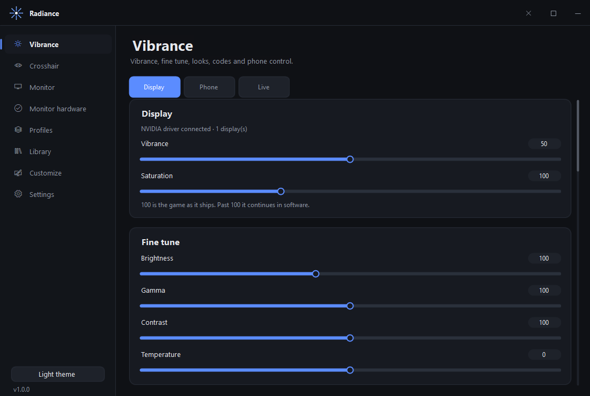
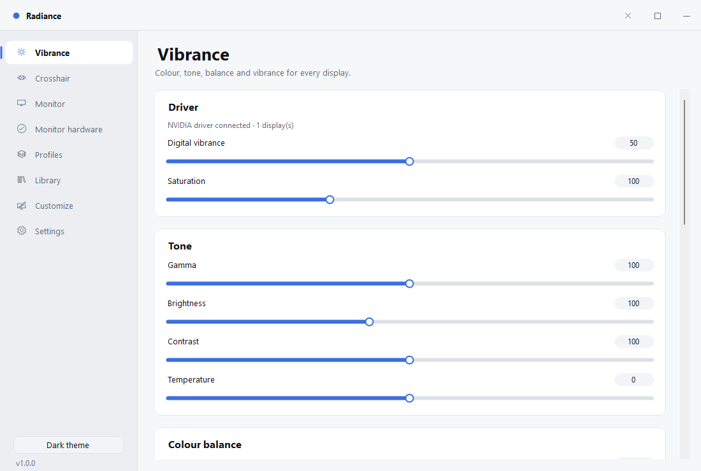
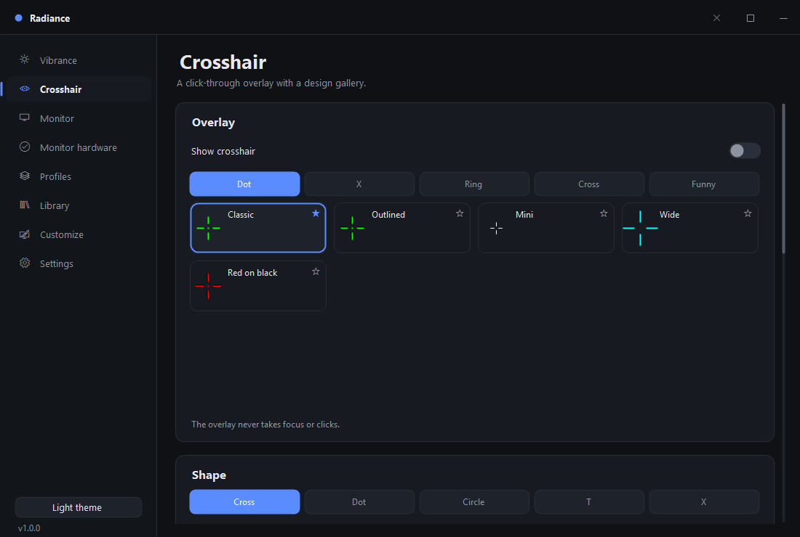
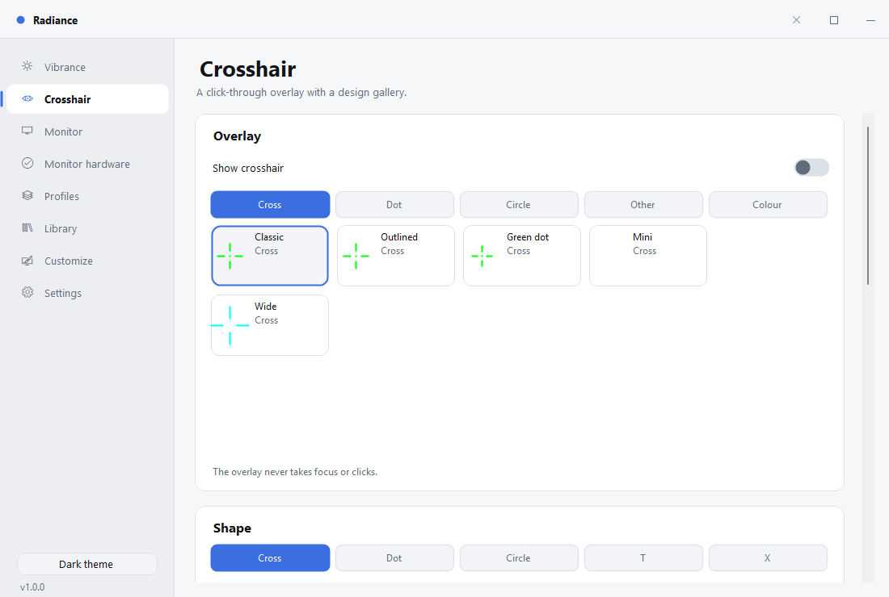
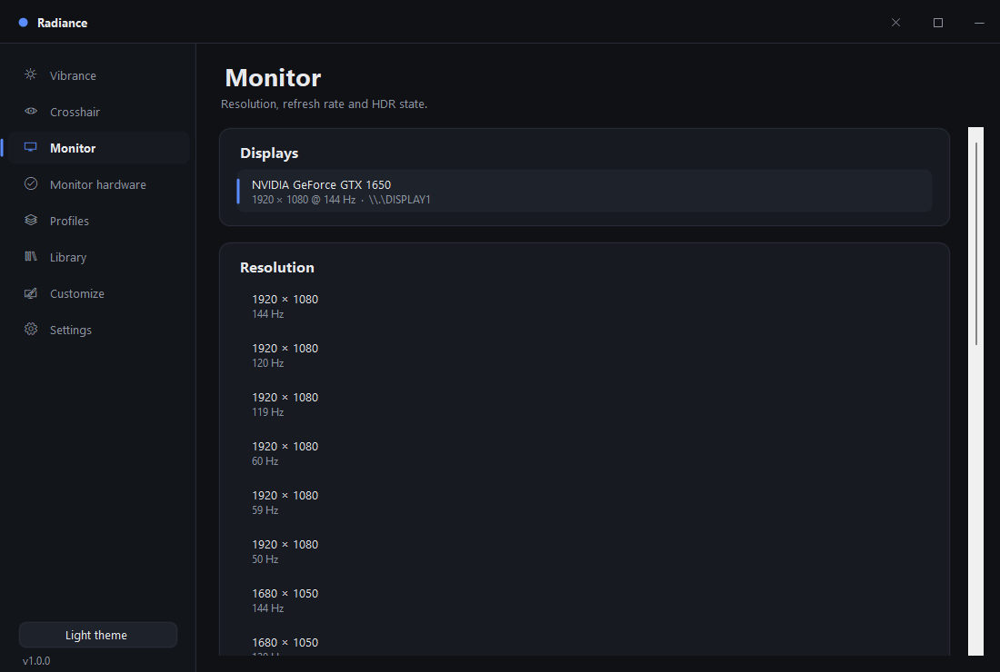
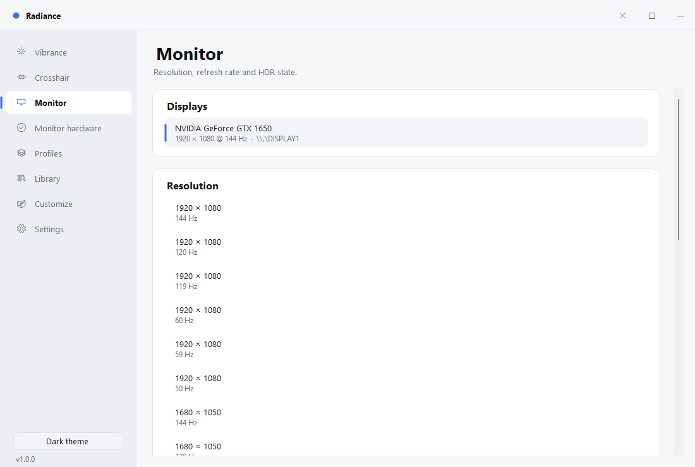
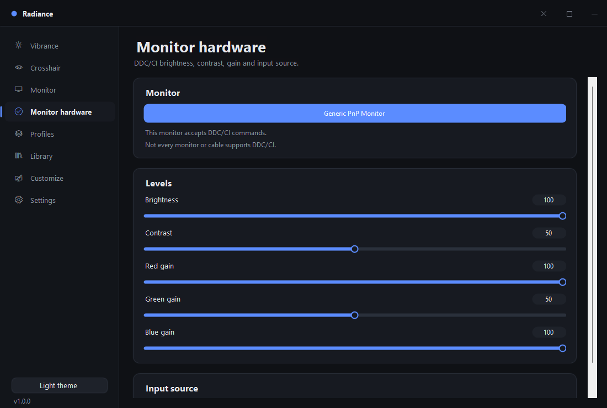
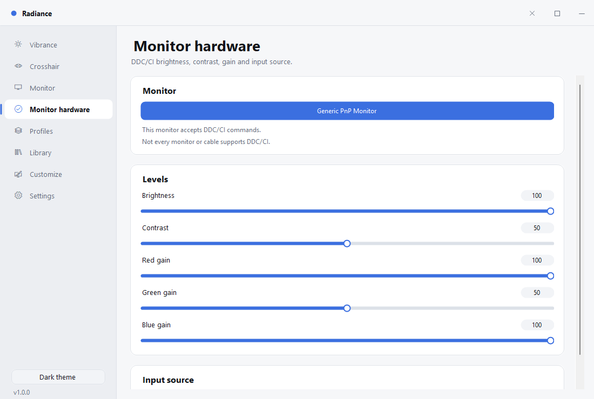

<div align="center">
  
  <h1>Radiance</h1>
  <p><b>Digital vibrance, colour and display control for Windows</b></p>
  <p>An original WinForms app with a custom-drawn interface and a fully local feature set.<br/>No accounts, no telemetry, no cloud dependencies.</p>

  <a href="https://git.io/typing-svg">
    
  </a>

  <br/><br/>

  <p>
    <a href="https://github.com/mstlvc/Radiance/releases/latest"></a>
    
    
    
    <a href="LICENSE"></a>
  </p>

  <br/>

  

</div>

<br/>

<details>
  <summary align="center"><b>📸 View Theme & Page Gallery (Dark vs Light)</b></summary>
  <br/>
  <div align="center">
    <table>
      <tr>
        <th align="center">Dark Theme</th>
        <th align="center">Light Theme</th>
      </tr>
      <tr>
        <td align="center"><br/><sub><b>Vibrance</b></sub></td>
        <td align="center"><br/><sub><b>Vibrance (Light)</b></sub></td>
      </tr>
      <tr>
        <td align="center"><br/><sub><b>Crosshair</b></sub></td>
        <td align="center"><br/><sub><b>Crosshair (Light)</b></sub></td>
      </tr>
      <tr>
        <td align="center"><br/><sub><b>Monitor Settings</b></sub></td>
        <td align="center"><br/><sub><b>Monitor (Light)</b></sub></td>
      </tr>
      <tr>
        <td align="center"><br/><sub><b>Hardware DDC/CI</b></sub></td>
        <td align="center"><br/><sub><b>Hardware (Light)</b></sub></td>
      </tr>
    </table>
  </div>
</details>

## Features

**Vibrance**
- NVIDIA digital vibrance through the driver (NVAPI DVC), applied to every display
- Saturation, gamma, brightness, contrast and colour temperature
- **Display / Phone / Live tabs**
- **Colour balance** – hue rotation plus red/green/blue gain
- **Levels** – shadows, blacks, whites, highlights, shadow tint, highlight tint
- **Colour vision** – simulate red/green/blue weakness, or correct for it (true per-pixel LMS)
- **Per-pixel colour** – optional D3D11 overlay: saturation up to 300 and colour-vision
  matrices applied to every pixel, on **every monitor** (one swap chain per output),
  not approximated through the gamma ramp
- **Share codes** – copy the whole look as `RDC-…`, paste one back (checksummed, all 20 colour fields)
- **Eye care** – warmth, screen dimming, or off
- **Compare** – flip back to neutral and return
- **Colour screenshots** – the active look is baked into the PNG, so the file matches the screen
- Reset to neutral

**Crosshair**
- Click-through, always-on-top overlay that never takes focus
- Per-arm toggles, diagonal arms, adjustable outline thickness
- **Design gallery** – 18 named designs across Cross, Dot, Circle, Other and Colour families
- Five shapes: cross, dot, circle, T, X
- Arm length, thickness, centre gap, opacity
- **Colour wheel** – HSV wheel with brightness bar and hex entry
- Centre dot, black outline
- **Share codes** – `RDCX-…`

**Monitor**
- Every attached display with its current mode
- Resolution and refresh-rate list, applied through `ChangeDisplaySettingsEx`
- **Scaling** – default, stretch, aspect and centred
- **Custom resolution** – width, height and refresh, with an NVAPI timing override
  when Windows refuses the mode
- **HDR** – read state per display and turn it on or off
- **Share codes** – `RDCM-…`

**Monitor hardware (DDC/CI)**
- Hardware brightness, contrast and RGB gain
- Input-source switching
- Reports when a monitor refuses DDC/CI instead of pretending it worked

**Profiles**
- Save the whole colour state as a named look
- Apply and delete profiles
- Game detection from your **Steam** and **Epic** libraries (local manifests only)
- Bind a profile to a game and have it apply automatically while the game runs

**Library**
- Built-in starting presets: Neutral, Competitive, Vivid, Night, Cinematic, Eye comfort

**Customize**
- Taskbar alignment, widgets button, Task View button, search mode
- Show file extensions, show hidden files
- Apply, or apply and restart Explorer

**Settings**
- **Light and dark themes** (verified at runtime; the whole window repaints)
- Start with Windows (launches silently in system tray), start minimised, minimise to tray
- **Hotkey picker** – click, press a combination, conflict checked against Windows
  and other apps before it is accepted
- **Theme from an image** – build a palette from a wallpaper
- **Audio limiter** – caps system volume at a chosen maximum
- **Quick popup** – hotkey-triggered vibrance slider that floats over everything
- Update check against GitHub releases
- Open settings folder, reset all settings

**Phone remote**
- Local web server: open the address on any phone on the same network
- Vibrance slider and a light/dark theme switch
- Random token in the URL is the only access control; nothing leaves the LAN
- No cloud, no account

**Discord presence**
- Rich presence over Discord's local IPC pipe, on by default with the built-in application id
- Reconnects automatically if Discord starts later, and updates the activity when you change look

**Shared presets**
- Any look file in `%APPDATA%\Radiance\shared`, imported or exported from the Library
- Accepts `.radiance-look`, `.json`, or a raw `RDC-…` code

**Diagnostics**
- One click (or `Radiance.exe --report`) writes a local zip: system, displays, settings, shader state
- Never uploaded

**Everywhere**
- App mark (taskbar, tray, title bar) generated from `Assets/radiance.png`
- Themed scrollbars and mouse-wheel paging on every page
- Tray icon with open, reset colours, turn off per-pixel colour, and exit
- Single instance
- Three-step first-run onboarding with a live vibrance preview

## Requirements

- Windows 10 or 11, x64
- .NET 8 (or use the self-contained publish below)
- An NVIDIA GPU for digital vibrance; the rest works on any GPU

## Build

```bash
dotnet build Radiance.slnx -c Release
```

### Self-contained single file

```bash
dotnet publish src/Radiance/Radiance.csproj -c Release -r win-x64 --self-contained true \
  -p:PublishSingleFile=true -p:EnableCompressionInSingleFile=false -p:DebugType=none
```

## Command line

```
Radiance.exe --report       write a diagnostics zip to the Desktop and exit
Radiance.exe --shared       list shared presets
Radiance.exe --screenshot   save a colour-baked screenshot and exit
Radiance.exe --discord      test the Discord pipe and print the result
Radiance.exe --gpu          report NVIDIA availability, display count and current vibrance
Radiance.exe --monitors     list physical monitors, DDC/CI support and HDR state
Radiance.exe --audio        print the current master volume
```

## Configuration

Everything is local, in `%APPDATA%\Radiance\`:

- `settings.json` – colour state, theme, hotkeys, crosshair, customizations
- `profiles.json` – saved looks
- `games.json` – game-to-profile bindings

Delete those files to reset the app.

## Renaming

All branding lives in [`Branding.cs`](src/Radiance/Branding.cs): name, tagline, version,
the GitHub repo used by the updater, and the settings folder. Change it there and every
surface follows.

## Project layout

```
src/Radiance/
  Branding.cs           name, version, data folder, update feed
  Theme.cs              palettes, fonts, drawing helpers
  AppSettings.cs        persisted settings, hotkey and crosshair models
  Program.cs            entry point, single instance
  Core/
    ColorPipeline.cs    settings -> hardware writes
    ToneState.cs        gamma, gain, blacks, highlights
    NvidiaVibrance.cs   NVAPI digital vibrance
    GammaRamp.cs        gamma / brightness / contrast / temperature
    ColourVision.cs     LMS matrices for simulate/correct
    ShaderOverlay.cs    D3D11 desktop-duplication overlay + 5x5 matrix
    CustomTiming.cs     NVAPI custom resolution timings
    AudioLimiter.cs     Core Audio master-volume cap
    ColourScreenshot.cs screenshot with the look baked in
    PhoneRemote.cs      local web server for phone control
    DiscordPresence.cs  Discord IPC rich presence
    SharedPresets.cs    local shared-look folder
    Diagnostics.cs      local support bundle
    ThemeFromImage.cs   palette derived from a wallpaper
    DisplayService.cs   monitors, modes, scaling, custom resolution
    MonitorHardware.cs  DDC/CI brightness, contrast, gain, input
    Hdr.cs              HDR state via DisplayConfig
    Profiles.cs         profile model, store and built-ins
    CrosshairDesigns.cs gallery designs
    ShareCodes.cs       RDC- / RDCX- codes
    Games.cs            Steam/Epic detection, game-to-profile map
    HotkeyManager.cs    global hotkeys
    Screenshot.cs       PNG capture
    CustomizeRegistry.cs taskbar and Explorer tweaks
    Updater.cs          GitHub release check
  UI/
    ShellForm.cs        window chrome, sidebar, header, navigation
    UiKit.cs            card, slider, toggle, segmented, list row, nav
    ColourWheel.cs      HSV wheel + brightness bar + hex
    HotkeyPicker.cs     capture with conflict detection
    DesignGallery.cs    crosshair design tiles
    QuickPopup.cs       floating vibrance slider
    TrayIcon.cs         tray presence
    CrosshairOverlay.cs click-through overlay
    OnboardingForm.cs   first-run welcome
    Pages/              one file per screen
```

## Notes on the colour pipeline

Digital vibrance is written per display with `SetDVCLevelEx`; 50 is the driver default
and 100 is maximum, so saturation scales the driver value (saturation 150 at vibrance 60
writes 90). The tone controls build a 256-entry ramp and push it with `SetDeviceGammaRamp`,
which some HDR displays ignore.

## Safety around the per-pixel overlay

The D3D11 overlay replaces what you see, so a crash while it is running could
leave the screen colour-shifted. Three guards exist:
- a marker file is written while it runs; an unclean exit disables it on next start
- a test hook (`RADIANCE_SHADER_TEST=1`) is capped at 120 seconds
- the tray menu has **Turn off per-pixel colour**

## Licence

MIT – see [LICENSE](LICENSE).

`libs/NvAPIWrapper.dll` is the [NvAPIWrapper](https://github.com/falahati/NvAPIWrapper)
managed wrapper for NVIDIA's NVAPI (MIT).
