<div align="center">
  <picture>
    <source media="(prefers-color-scheme: dark)" srcset="docs/logo.png" />
    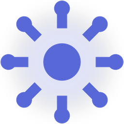
  </picture>
  <h1>Radiance</h1>
  <p><b>Digital vibrance, colour, resolution and monitor control for Windows</b></p>
  <p>A native C++ tray app with a custom-drawn Dear ImGui interface and a fully local feature set.<br/>No accounts, no telemetry, no cloud dependencies.</p>

  <a href="https://github.com/DenverCoder1/readme-typing-svg">
    <picture>
      <source media="(prefers-color-scheme: dark)" srcset="https://readme-typing-svg.demolab.com?font=Fira+Code&weight=600&size=16&pause=1000&color=ABBDFF&center=true&vCenter=true&width=560&lines=NVIDIA+Digital+Vibrance+via+Driver;Resolution%2C+Scaling+%26+Custom+Modes;DDC%2FCI+Monitor+Control;Per-Game+Profiles+%26+Quick+Popup;Radiance+%26+macOS+Themes%2C+Dark+%26+Light;Zero+Bloat+%E2%80%A2+100%25+Local+%E2%80%A2+No+Account+Required" />
      
    </picture>
  </a>

  <br/><br/>

  <p>
    <a href="https://github.com/mstlvc/Radiance/releases/latest"></a>
    
    
    
    
    <a href="LICENSE"></a>
  </p>

  <br/>

  <picture>
    <source media="(prefers-color-scheme: dark)" srcset="docs/screenshots/display-radiance-dark.png" />
    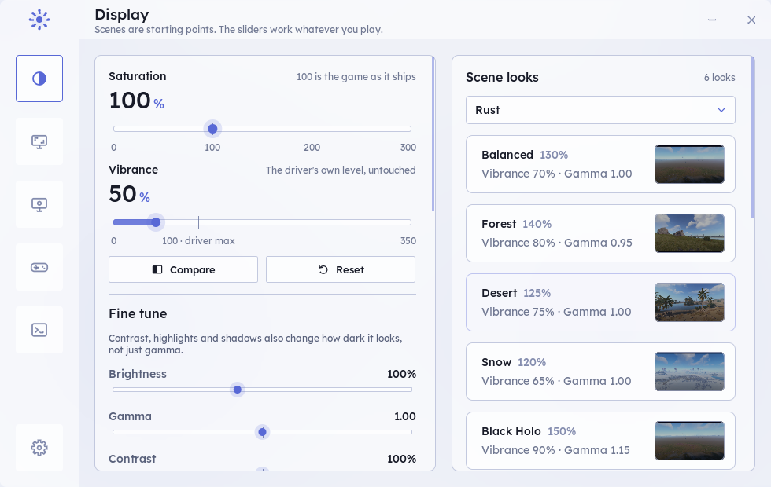
  </picture>

</div>

<br/>

Radiance lives in the tray, starts with Windows and puts your look back on whenever you play.

- **NVIDIA digital vibrance**, saturation, gamma and a full set of colour controls, applied to
  the screen rather than to a game, so nothing ever touches a game's files or memory.
- **Resolution, refresh rate and scaling**, including stretched 4:3, NVIDIA integer scaling and
  custom resolutions, always behind a "keep this setting?" countdown.
- **Monitor control over DDC/CI**: your monitor's own brightness, contrast, colour and input,
  without reaching round the back.
- **Per-game profiles**: a look and a launch resolution for each game, switched on when the
  game opens and put back when it closes.
- **Shortcuts**: a quick colour popup over any game, and screenshots with your colours in them.
- **Two themes, each dark or light.**

## Screenshots

**Themes.** *Radiance* (its own look) and *macOS* (after macOS Sequoia), each dark or light,
switched live in Settings.

| | Dark | Light |
|---|---|---|
| **Radiance** | 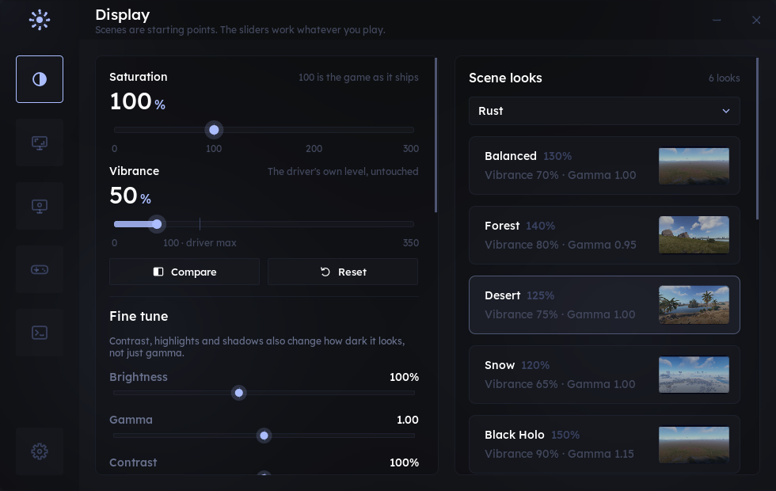 |  |
| **macOS** | 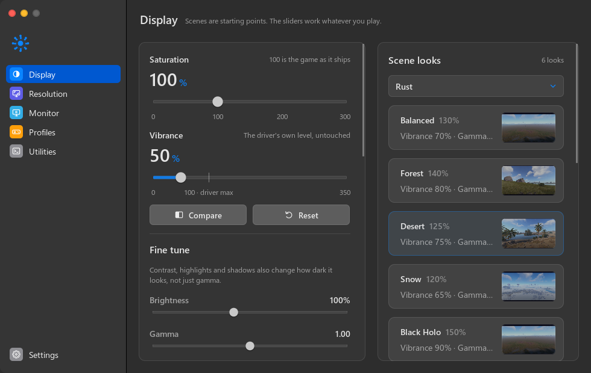 | 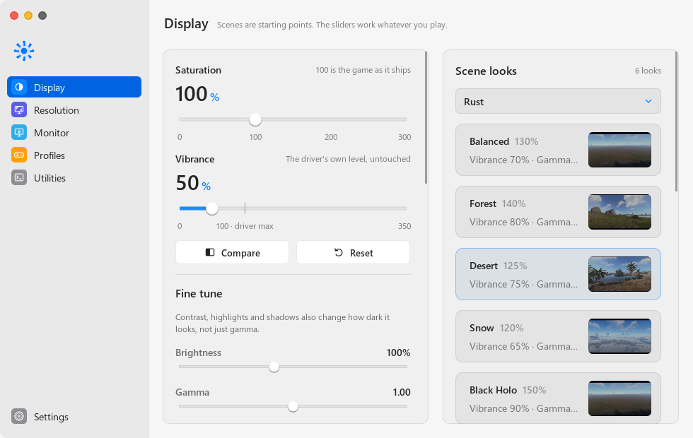 |

**Pages.**

| | |
|---|---|
| 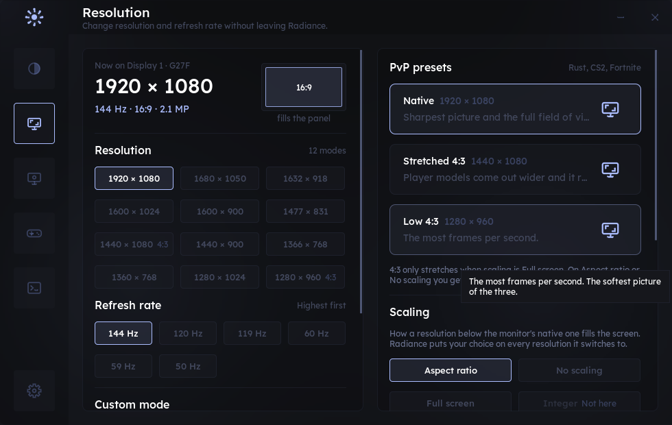 | 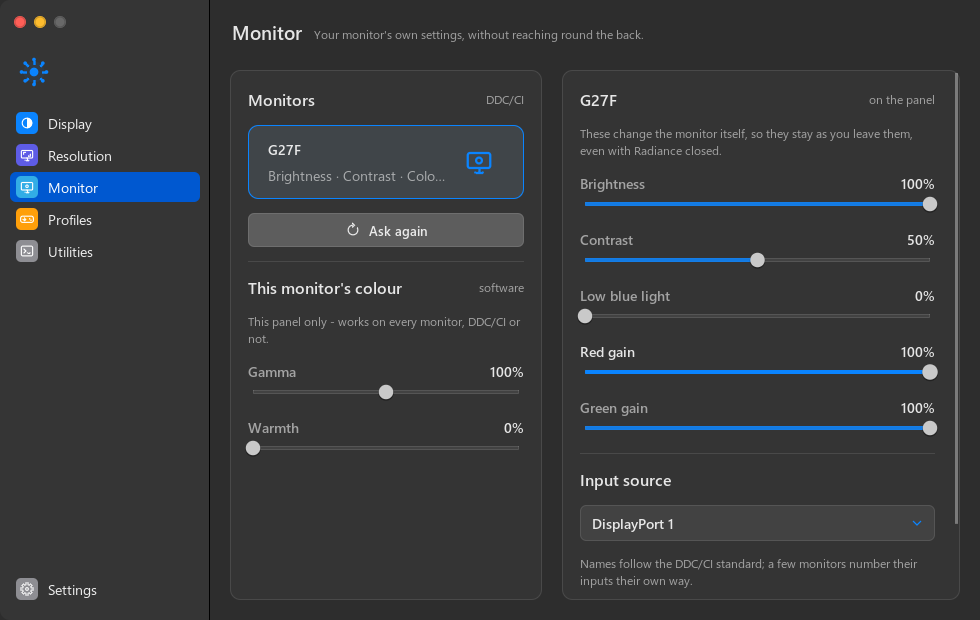 |
| **Resolution** - modes, refresh rates, PvP presets, scaling, launch resolutions | **Monitor** - DDC/CI controls and per-display colour |
| 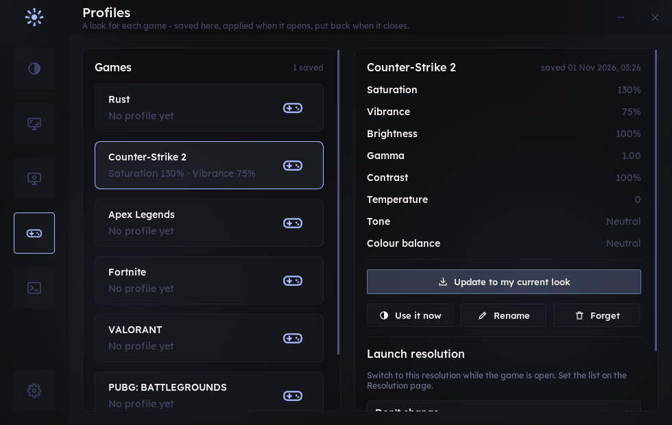 | 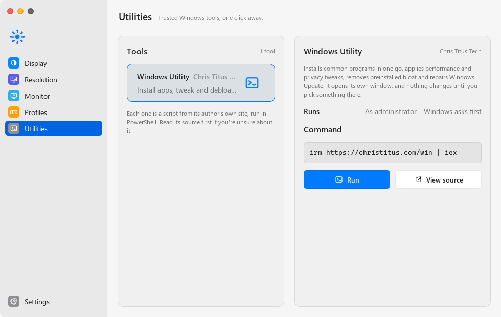 |
| **Profiles** - a look for each game | **Utilities** - Windows tools, one click away |
| 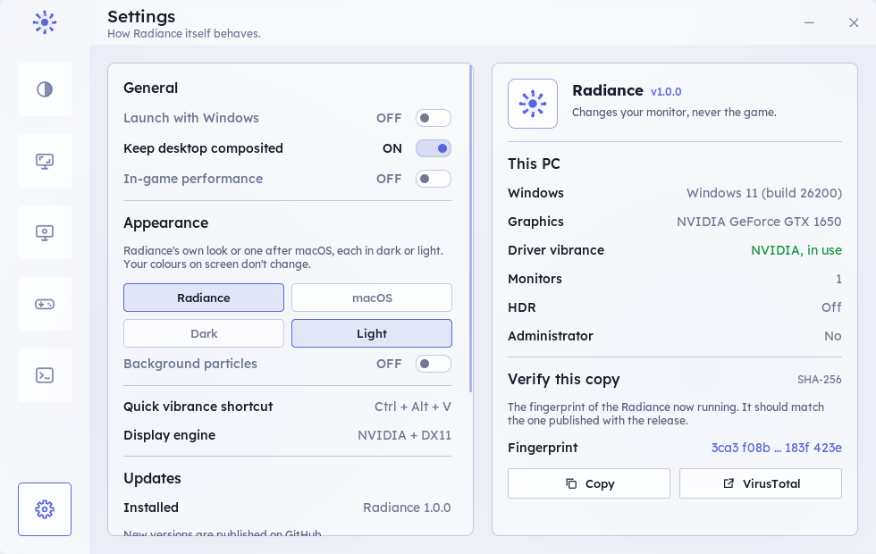 | 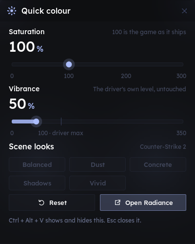 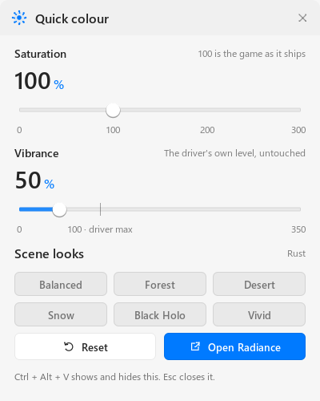 |
| **Settings** - startup, appearance, diagnostics | **Quick colour popup** (Ctrl + Alt + V) |

## Features

### Display (colour)

- **Vibrance** uses the NVIDIA driver's own digital vibrance up to 100 (50 is the driver's
  default, 100 its maximum); past 100 Radiance carries on in software. Until you move it, the
  slider shows the driver's current level and Radiance never writes it, so starting Radiance
  doesn't override NVIDIA Control Panel. Without an NVIDIA GPU the whole range is software.
- **Saturation, brightness, gamma, contrast, temperature**, a tone curve (highlights, shadows,
  blacks, whites, shadow and highlight tint), **hue** and **RGB gains**.
- **Eye care**: warmth and dimming on top of whatever look is on.
- **Colour vision** correction for red-weak, green-weak and blue-weak sight (protanopia,
  deuteranopia, tritanopia).
- **Scene looks** for Rust, Counter-Strike 2, Fortnite and PUBG, your own saved looks, and
  share codes to pass a look to someone else.
- **Compare** switches to the untouched picture until you switch back.

### Resolution

- Every mode and refresh rate the display offers, plus any custom width, height and rate.
- **PvP presets**: native, stretched 4:3 and low 4:3.
- **Scaling**: aspect ratio, no scaling, full screen, and NVIDIA **integer** scaling where the
  driver offers it. Your choice is put on every lower resolution Radiance switches to, so
  stretched 4:3 really stretches.
- **Custom resolutions**: a mode the display doesn't list is tried as an NVIDIA custom
  resolution and only saved to the driver if you keep it.
- Every change shows a 15-second **keep or go back** countdown. A mode the monitor can't show
  leaves the screen black, so nothing is kept without a yes.

### Monitor (DDC/CI)

- Brightness, contrast, low blue light, red and green gain, and the input source (HDMI 1,
  DisplayPort 1...), read from and sent to the monitor itself.
- **Put it back** restores what the monitor had before Radiance touched it.
- Per-display software gamma and warmth, for monitors without DDC/CI.

### Profiles and games

- Rust, Counter-Strike 2, Apex Legends, Fortnite, VALORANT and PUBG are recognised when they
  start. A game's **profile** look replaces yours while it runs (the Display page then edits
  the profile) and yours comes back when it closes.
- A **launch resolution** per game, switched when the game opens and put back when it closes.
- A game Radiance has looks for, but no profile, gets one **offered**.

### Shortcuts

| Shortcut | Does |
|---|---|
| Ctrl + Alt + V | The **quick colour popup**: saturation, vibrance and scene looks over the game. Click back into the game, press Esc or the shortcut again to hide it. |
| Ctrl + Alt + S | A **screenshot with your colours**: Windows captures the screen before the gamma ramps, the colour filter and NVIDIA vibrance, so Radiance applies the look to the image itself. Saved to Pictures\Radiance and copied. |
| (off) | Open the main window. |

All three can be changed on the Display page.

### Utilities

Trusted Windows tools started with one click, each its author's own PowerShell one-liner,
shown in full beside **Run** (through Windows' administrator prompt) and **View source**.
Radiance ships with Chris Titus Tech's [Windows Utility](https://github.com/ChrisTitusTech/winutil).

### Themes and the app

- **Radiance** and **macOS** themes, each **dark** or **light**, switched live. The macOS theme
  follows macOS Sequoia: traffic lights, a sidebar of labelled rows, grouped sections, pill
  switches, the system blue, and Windows' Segoe UI.
- An optional drifting particle network behind the window (off by default).
- The tray icon follows a light or dark taskbar.
- Radiance starts in the tray with Windows; closing the window sends it back to the tray.

## Download

Get **Radiance.exe** from the [latest release](https://github.com/mstlvc/Radiance/releases/latest):
a single file with nothing to install, for Windows 10 or 11 (64-bit).

## Build

Radiance builds to a single `Radiance.exe` (static runtime, everything embedded).

Needs Windows 10 or 11 and Visual Studio 2022 (or its Build Tools) with the **Desktop
development with C++** workload; CMake and Ninja come with it.

```bat
build.bat          :: Release -> build\Release\Radiance.exe
build.bat debug    :: Debug   -> build\Debug\Radiance.exe
```

You can also open the folder in Visual Studio ("Open a local folder"); it picks up
`CMakeLists.txt`.

## Running

- Launching it opens the window. Closing the window (or Esc) sends it to the tray; **Exit** is
  in the tray menu.
- `Radiance.exe --tray` starts it hidden in the tray. That is what the Windows startup entry
  uses (`HKCU\Software\Microsoft\Windows\CurrentVersion\Run\Radiance`), and **Launch with
  Windows** is on by default.
- Only one copy runs; launching it again brings the window up.
- Settings live in `%APPDATA%\Radiance\radiance.json`. `RADIANCE_DATA_DIR` points it at
  another folder (portable copies, testing).
- `--isolated` starts a test copy beside a running one, with no one-copy check, startup
  entry, global shortcuts, game watching or tray icon, so it can't disturb the real one. Use
  it with `RADIANCE_DATA_DIR`.

When Radiance exits, Windows shuts down or Radiance crashes, the screen goes back to how
Radiance found it: the driver's vibrance level, each display's own gamma ramp, no colour
filter. If it stops in the middle of a game, the next start puts your own look and the saved
display mode back first.

## How it works

**Colour** (`src/services/ColourEngine.cpp`) reaches the screen in three stages:

1. **NVIDIA Digital Vibrance** through NVAPI (`nvapi64.dll`, loaded at run time), on displays
   an NVIDIA GPU drives.
2. **Gamma ramps**, one per display (`SetDeviceGammaRamp`): gamma, the tone curve, brightness,
   contrast, temperature, RGB gains, eye care and the display's own gamma and warmth. A
   display's calibration ramp is remembered and handed back; when Windows refuses a strong
   ramp, a gentler one is tried.
3. **The full-screen colour filter** (Magnification API): saturation, software vibrance, hue
   and colour-vision correction.

Games and mode changes reset ramps, so the look is checked every 5 seconds and about 2 seconds
after the foreground window or the display mode changes.

**Resolution** (`src/services/DisplayService.cpp`) switches for the session only
(`ChangeDisplaySettingsEx` without the registry) and saves the mode only on **Keep**. Scaling
goes through the NVIDIA driver's display config on NVIDIA displays
(`src/platform/NvidiaDisplay.cpp`) and through Windows' display paths elsewhere.

**DDC/CI** (`src/services/MonitorControl.cpp`) reads each monitor's capabilities and values
(dxva2) on a worker thread; writes go through a queue drained by a thread of its own, keeping
only the latest value per control while a slider moves. Commands are spaced 50 ms apart, as
monitors drop about half of them otherwise.

**Games** (`src/services/GameWatcher.cpp`) are spotted from the running programs every 3
seconds and shortly after the foreground window changes.

## Project layout

```
src/
  app/        App: window, message loop, tray, startup entry, shortcuts, quick popup, DPI
  core/       plain data: models, settings (JSON), catalogue (games, looks, utilities),
              share codes, colour maths, DDC/CI capability parsing
  services/   what the pages use to touch the machine: colour engine, display service,
              DDC/CI monitor control, game watcher
  platform/   Win32 / DX11 / driver helpers: renderer, textures, tray, startup, NVAPI
              vibrance, gamma ramps, colour filter, display modes and scaling, NVIDIA scaling
              and custom resolutions, DDC/CI, processes, screenshots
  ui/         theme tokens, fonts, icons, widgets, backdrop, shell, quick popup
  ui/pages/   Display, Resolution, Monitor, Profiles, Utilities, Settings
res/          icons, manifest, version info, Lexend fonts, scene-look thumbnails
tools/        make_icon.py, which draws the icons and the README logo from the app's mark
docs/         screenshots and the README logo
third_party/  Dear ImGui 1.90 (with the changes below) and FreeType
```

### Changes to the bundled Dear ImGui

- `imgui_widgets.cpp`: the text field keeps a square for an icon on the right, and the text
  field and scrollbar take their colours from `imgui_radiance.h` (set by `ui::ApplyStyle()`).
- `imgui.cpp`: a frame-rate-dependent scroll easing in `Begin()` is removed (upstream
  behaviour); panels do time-based smooth scrolling instead.
- `imgui_freetype.*` sits in `misc/freetype/`, where `imgui_draw.cpp` expects it.

## Credits and licences

Radiance is MIT-licensed; see [LICENSE](LICENSE).

- [Dear ImGui](https://github.com/ocornut/imgui) by Omar Cornut, MIT
  ([third_party/imgui/LICENSE.txt](third_party/imgui/LICENSE.txt)).
- [FreeType](https://freetype.org) 2.12.1, FreeType License
  ([third_party/freetype/FTL.TXT](third_party/freetype/FTL.TXT)): portions of this software
  are copyright © The FreeType Project (www.freetype.org). All rights reserved.
- [Lexend](https://github.com/googlefonts/lexend), SIL Open Font License 1.1
  ([res/fonts/OFL.txt](res/fonts/OFL.txt)).
- The macOS theme's colours and sizes follow
  [imgui-apple](https://github.com/MisterJerkins/imgui-apple) (CupertinoUi), MIT,
  copyright (c) 2026 MisterJerkins. Its Apple fonts and symbols are not used; the macOS theme
  sets its text in Windows' own Segoe UI, read from the system at run time.
- The NVAPI structures in `src/platform/NvidiaDisplay.cpp` follow
  [NVIDIA's nvapi.h](https://github.com/NVIDIA/nvapi), MIT, copyright (c) 2019-2026 NVIDIA
  Corporation & Affiliates.

Not affiliated with NVIDIA, Microsoft or Apple. NVIDIA, Windows and macOS are trademarks of
their owners.
